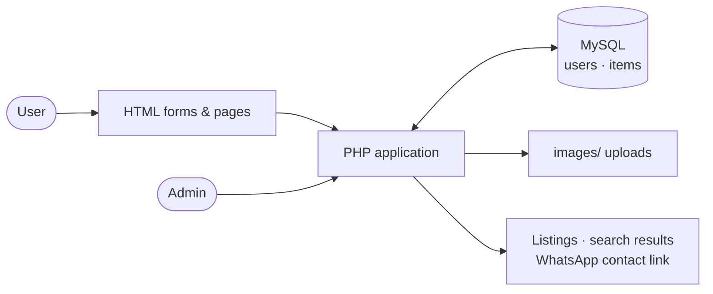

<p align="center">
  
</p>

<p align="center">
  A web app where people report lost or found belongings, search the listings, and contact each other directly.
</p>

<p align="center">
  <a href="https://lostfoundd.freedev.app/">
    
  </a>
</p>

<p align="center">
  <sub><a href="https://github.com/Pankaj-Jhajhria/Lost-and-Found">View Source</a> · Live at <a href="https://lostfoundd.freedev.app/">lostfoundd.freedev.app</a></sub>
</p>

---

## ✨ Key features

<table>
  <tr>
    <td width="50%" valign="top">
      <b>🔐 Accounts</b><br>
      Sign up with name, email, phone and password, then log in and out. Passwords are stored as hashes.
    </td>
    <td width="50%" valign="top">
      <b>📝 Report lost or found items</b><br>
      Post an item with a description, a location and an optional photo (JPG, PNG, GIF or WEBP, up to 2 MB).
    </td>
  </tr>
  <tr>
    <td valign="top">
      <b>🔍 Browse, filter and search</b><br>
      See every listing, filter by Lost or Found, or search by item name and description. Each card has a WhatsApp contact button.
    </td>
    <td valign="top">
      <b>⚙️ Admin panel</b><br>
      View totals (all, lost, found) and delete any listing. Admin access is configured on the server, not through signup.
    </td>
  </tr>
</table>

## 🧭 How it works



Users submit HTML forms that are handled by PHP scripts. The scripts read and write two MySQL tables, `users` and `items`, and store uploaded photos in `images/`. Listings and search results are rendered by PHP, and the admin panel can remove listings.

## 🧰 Technology stack

| PHP | MySQL | HTML | CSS |
|:---:|:---:|:---:|:---:|
| Sessions, `mysqli`, prepared statements | `users` and `items` tables (`schema.sql`) | Forms and page structure | Shared `style.css`, dark theme |

A little vanilla JavaScript powers the Lost/Found filter and the dashboard animation.

## 🚀 Run locally

You need **PHP** (with the `mysqli` extension) and **MySQL or MariaDB**.

1. **Create a database** and import the schema:
   ```bash
   mysql -u YOUR_USER -p YOUR_DATABASE < schema.sql
   ```
   (phpMyAdmin's Import tab works too.)
2. **Create your config** from the template and fill in your database details:
   ```bash
   cp db.example.php db.php
   ```
   In `db.php`, also set `ADMIN_EMAIL` and `ADMIN_PASSWORD_HASH`. Generate the hash with:
   ```bash
   php -r "echo password_hash('YourStrongPassword', PASSWORD_DEFAULT);"
   ```
3. **Start a PHP server** from the project folder and open `http://localhost:8000`:
   ```bash
   php -S localhost:8000
   ```

The built-in server is for local testing only. On Apache hosting, `images/.htaccess` blocks script execution in the upload folder.

## 🔒 Security and project status

- `db.php` holds your credentials and is listed in `.gitignore`. Never commit it.
- Passwords use `password_hash()`. Uploads are checked for type, size and errors. Queries are prepared. Deleting a listing requires a POST request with a CSRF token.
- The live demo is hosted at [lostfoundd.freedev.app](https://lostfoundd.freedev.app/).

---

<p align="center">
  Built by <b>Pankaj</b> · <a href="https://github.com/Pankaj-Jhajhria/Lost-and-Found">Source on GitHub</a>
</p>
